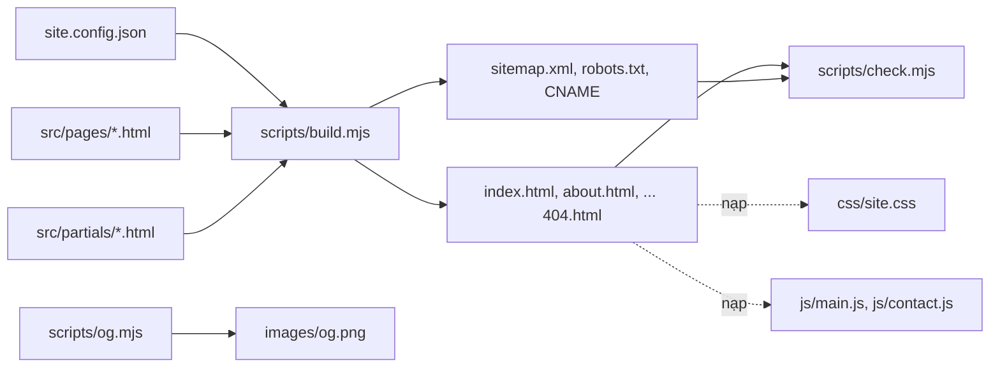
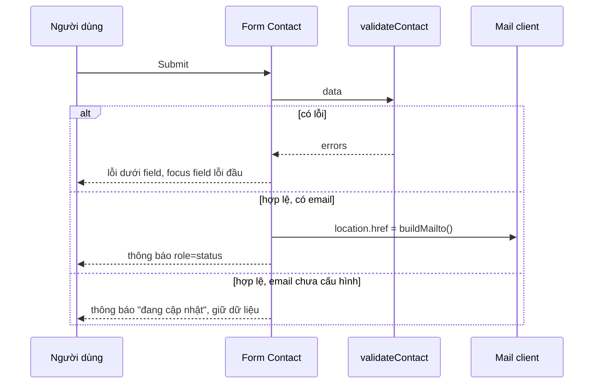

# Tài liệu Design: Website Synthiq

## Tổng quan

Đáp ứng [requirements.md](./requirements.md). Synthiq giữ **kiến trúc thông tin** của Site nguồn (5 trang, danh sách section theo Requirement 1) nhưng **không sao chép file nào** từ `../Landing-DVTechnic`: HTML, CSS, JS, ảnh đều viết mới. Như vậy loại bỏ tận gốc Dấu vết DVTechnic/Solvet, thư viện thừa (Bootstrap, jQuery, GSAP…) và 33 MB ảnh.

Trang được viết dưới dạng template trong `src/`, một script build Node không phụ thuộc thư viện ghép partial (header, footer…) và chèn thông tin thương hiệu từ một file duy nhất `site.config.json`, rồi xuất HTML tĩnh ra gốc repo. HTML xuất ra được commit, GitHub Pages phục vụ trực tiếp từ gốc nhánh. Bộ kiểm tra (`scripts/check.mjs`) rà HTML đã build theo Requirement 4–6 và yêu cầu phi chức năng.

Giao diện: nền sáng ấm, nhấn cam/san hô, tiêu đề serif (Fraunces) + chữ thân sans (Manrope), hero chia đôi có minh hoạ SVG, các section kiểu editorial/bento thay cho layout Bootstrap của Site nguồn.

## Kiến trúc



- Lệnh `npm run build`: đọc config + template, render, ghi 6 trang HTML và 3 file SEO ở gốc repo.
- Lệnh `npm run check`: chạy Bộ kiểm tra trên kết quả build; in lỗi dạng `file:dòng: mô tả`, thoát mã 1 nếu có lỗi.
- Lệnh `npm test`: vitest (unit + property-based + DOM test với jsdom).
- Lệnh `npm run og`: sinh `images/og.png` 1200×630 từ SVG (chạy khi đổi nhận diện; ảnh được commit).
- Lúc chạy trên trình duyệt chỉ có 1 file CSS, 1 file JS chung (`js/main.js`) và `js/contact.js` riêng trang Contact; không có thư viện bên thứ ba.

## Thành phần và giao diện

### Cấu hình thương hiệu

- Vị trí: `site.config.json`
- Trách nhiệm: nguồn duy nhất cho Thông tin thương hiệu (Requirement 3.2, 3.3, 3.6). Trường rỗng `""` nghĩa là chưa cung cấp.

```json
{
  "name": "Synthiq",
  "domain": "synthiqdigital.com",
  "email": "",
  "phone": "",
  "address": "",
  "taxId": "",
  "hours": "",
  "social": { "linkedin": "", "github": "", "facebook": "" }
}
```

Build suy ra thêm: `url` = `https://` + domain, `year` = năm hiện tại, `phoneHref` = `phone` bỏ khoảng trắng, `hasContact` = có ít nhất một trong email/phone/address/taxId/hours.

### Template engine

- Vị trí: `scripts/lib/render.mjs`
- Trách nhiệm: render chuỗi template thuần, không I/O.
- Cú pháp hỗ trợ (cố ý tối giản):
  - `{{> name}}`: chèn partial `src/partials/name.html` (cho phép lồng, tối đa 5 cấp, phát hiện vòng lặp).
  - `{{key}}`, `{{social.linkedin}}`: chèn giá trị, escape HTML (`& < > " '`).
  - `{{#if key}}…{{else}}…{{/if}}`: giữ khối khi giá trị khác rỗng (cho phép lồng).
  - Front matter ở đầu trang: các dòng `key: value` giữa hai dòng `---` (title, description, path, nav, scripts).

```js
export function render(template, ctx, partials) // => string; ném RenderError nếu thiếu key/partial
export function parsePage(source)               // => { meta, body }
export function escapeHtml(s)                   // => string
```

### Build

- Vị trí: `scripts/build.mjs`, dùng `scripts/lib/render.mjs`, `scripts/lib/site.mjs`.
- `site.mjs`: `loadConfig(path)` (validate kiểu, domain bắt buộc), `buildContext(config, pageMeta)`, `sitemapXml(url, paths)`, `robotsTxt(url)`.
- Mỗi trang render qua `src/partials/layout.html` (head SEO, header, `{{> body}}`, footer). Ghi file theo `path` trong front matter: `/` → `index.html`, `/about` → `about.html`… Giữ URL `.html` như Site nguồn.
- Head mỗi trang: `<html lang="en">`, title, meta description, canonical `{{url}}/{{file}}` (Home: `{{url}}/`), `og:title/description/url/image/type`, `twitter:card`, favicon SVG, preload 2 font.

### Trang và partial

- Vị trí: `src/pages/{index,about,services,portfolio,contact,404}.html`, `src/partials/{layout,header,footer,cta,contact-items}.html`.
- `header.html`: logo, nav 5 mục (mục active qua `nav` trong front matter → `aria-current="page"` + class `is-active`), nút "Start a project" → `contact.html`, nút mở menu mobile (`aria-controls`, `aria-expanded`), panel mobile chứa nav + `{{> contact-items}}`.
- `contact-items.html`: mỗi mục email/phone/address/taxId/hours bọc trong `{{#if}}`; dùng chung cho header mobile, footer, trang Contact.
- `footer.html`: logo + tagline, Company links, Services links, khối liên hệ (chỉ khi `hasContact`), mạng xã hội (chỉ mục có giá trị), `© {{year}} Synthiq`.
- Nội dung từng trang (copy tiếng Anh viết mới, đánh dấu mẫu trong README):

| Trang | Section (thứ tự) |
|---|---|
| Home | Hero chia đôi (eyebrow, H1 serif, mô tả, 2 CTA, minh hoạ SVG "signal mesh" + 3 chip số liệu); dải 4 chỉ số; 3 dịch vụ chính dạng bento; "Why Synthiq" 3 điểm đánh số lớn; tech stack 8 chip; CTA |
| About | Page header; "Our story" 2 cột; 4 chỉ số; Mission + 4 giá trị; quy trình 4 bước dạng timeline ngang (dọc trên mobile); CTA |
| Services | Page header; 6 dịch vụ (tiêu đề, mô tả, 3 ý); 2 giải pháp tiêu biểu "Synthiq Relay" (nền tảng telecom/messaging) và "Synthiq Pilot" (AI agent cho vận hành); 3 mô hình hợp tác; CTA |
| Portfolio | Page header; dải số liệu; 1 dự án nổi bật; bộ lọc All / AI & Automation / Telecom / Enterprise / Fintech; 8 case study (2 mỗi lĩnh vực); CTA |
| Contact | Page header; thẻ liên hệ (`{{> contact-items}}`, ẩn cả khu vực khi `!hasContact` và thay bằng dòng "Use the form below"); "What happens next" 3 bước; form |
| 404 | Thông báo, link về Home và Contact |

### Hành vi phía trình duyệt

- Vị trí: `js/main.js` (ES module, mọi trang), `js/contact.js` (chỉ Contact).
- `main.js`:
  - Thêm class `js` vào `<html>` ngay đầu (script nhỏ inline trong head); mọi trạng thái ẩn (menu mobile, reveal) chỉ áp dụng dưới `.js`, nên tắt JS vẫn thấy đủ nội dung (5.6).
  - `initMenu(root)`: toggle panel, cập nhật `aria-expanded`, đóng khi bấm nút đóng, Esc, hoặc bấm link; trả focus về nút mở.
  - `filterCases(items, category)` (thuần) + `initFilter(root)`: nút lọc là `<button aria-pressed>`; ẩn thẻ bằng thuộc tính `hidden`; cập nhật vùng `aria-live` "Showing N projects".
  - `initReveal()`: IntersectionObserver thêm class `is-visible`; bỏ qua hoàn toàn nếu `prefers-reduced-motion: reduce` hoặc không có IntersectionObserver.
- `contact.js`:
  - `validateContact(data)` (thuần) → `{ valid, errors: [{ field, message }] }` theo thứ tự field `name, email, message`; trim trước khi kiểm; email theo regex `^[^\s@]+@[^\s@]+\.[^\s@]+$`, tối đa 254 ký tự; `company`, `service` tuỳ chọn.
  - `buildMailto(to, data)` (thuần) → `mailto:<to>?subject=…&body=…` dùng `encodeURIComponent`.
  - `initContactForm(form)`: `novalidate`; khi submit: xoá lỗi cũ, nếu lỗi thì ghi message vào `<p id="<field>-error">`, đặt `aria-invalid="true"`, focus field lỗi đầu tiên; nếu hợp lệ và `form.dataset.email` khác rỗng thì `location.href = buildMailto(...)` và hiện thông báo thành công trong `role="status"`; nếu email rỗng thì hiện thông báo "Our contact channel is being set up…", không xoá dữ liệu (5.7).

### Bộ kiểm tra

- Vị trí: `scripts/check.mjs` (CLI), logic thuần trong `scripts/lib/checks.mjs`.

```js
export const TRACE_PATTERNS   // regex không phân biệt hoa/thường: dvtechnic, dv technic, dongle@, 0111058171,
                              // 915 708 055, 0915708055, yen hoa, cau giay, openclaw, hermes, nous research, \bnous\b,
                              // solvet, templatemonster, drtheme
export function findTraces(text)                       // => [{ line, match }]
export function findBadFileNames(paths)                // => paths chứa dvtechnic|hermes|nous|logo copy
export function findMissingRefs(html, file, exists)    // => [{ line, ref }] cho href/src nội bộ không tồn tại
export function checkPageMeta(html, { url, file })     // => [message] theo 6.1, 6.2
export function checkContactLinks(html, config)        // => [message] mailto/tel khác config hoặc khi config rỗng
export function sharedNgrams(a, b, n = 8)              // => [ngram] các chuỗi n từ trùng (đã chuẩn hoá)
export function contrastRatio(hexA, hexB)              // => number
```

- CLI quét: mọi file văn bản tracked (trừ `specs/`, `node_modules/`, `.git/`) cho traces; mọi đường dẫn file cho tên xấu; 6 trang HTML cho ref, meta, mailto/tel; `sitemap.xml` (đúng 5 URL), `robots.txt` (`Allow: /`, dòng `Sitemap:`), `CNAME` (= domain); kích thước ảnh (`images/**` tổng < 6 MB, từng file ≤ 400 KB); mọi file trong `css/`, `js/`, `fonts/` được ít nhất 1 trang tham chiếu và ngược lại; không có `<script src>` trỏ ra ngoài domain; cặp màu token trong `css/site.css` (khai báo trong danh sách cố định ở `checks.mjs`) đạt ≥ 4.5:1.
- Cờ `--source <dir>`: so 8-gram giữa chữ hiển thị của từng trang Synthiq với toàn bộ trang Site nguồn (3.1). Không truyền cờ thì bỏ qua bước này và in nhắc.

### Hệ thống giao diện

- Vị trí: `css/site.css` (một file, khoảng 800–1200 dòng, CSS custom properties, không framework).
- Token chính:

| Token | Giá trị | Dùng cho |
|---|---|---|
| `--bg` | `#FFFAF5` | nền trang |
| `--surface` | `#FFFFFF` | card |
| `--tint` | `#FFE9DF` | nền section nhấn, chip |
| `--ink` | `#1F1A17` | chữ chính, nền footer |
| `--muted` | `#5C524C` | chữ phụ (≥ 4.5:1 trên `--bg`) |
| `--accent` | `#C2410C` | nút, link, chữ nhấn (≥ 4.5:1 với trắng) |
| `--accent-soft` | `#FF7A59` | hình trang trí, gạch chân, không dùng cho chữ |
| `--line` | `#EADFD6` | viền 1px |

- Font tự host trong `fonts/` (woff2, subset latin, giấy phép OFL): Fraunces (tiêu đề, 600) và Manrope (400/600/700), `font-display: swap`.
- Ngôn ngữ hình khối: card bo 20px, viền 1px `--line`, không đổ bóng đậm; hover nâng 2px + viền chuyển `--accent`; nút dạng pill; số lớn serif; đường gạch san hô dưới từ khoá trong tiêu đề. Breakpoint 640/992/1280px; container tối đa 1200px.
- Minh hoạ: SVG tự vẽ trong `images/` (hero mesh, icon dịch vụ dạng line, thumbnail case study dạng pattern hình học theo lĩnh vực). Không dùng ảnh chụp.
- Logo: `images/logo.svg` (chữ ink) và `images/logo-light.svg` (chữ trắng cho footer), biểu tượng là chữ "S" ghép từ hai cung tròn san hô; `favicon.svg` ở gốc.
- Chuyển động: reveal (fade + dịch 12px, 400ms), hover; `@media (prefers-reduced-motion: reduce)` tắt mọi transition/animation.

## Mô hình dữ liệu

- `site.config.json` như trên. `loadConfig` báo lỗi nếu `name`/`domain` rỗng hoặc trường không phải chuỗi.
- Front matter trang:

| Khoá | Ví dụ | Bắt buộc |
|---|---|---|
| `title` | `Synthiq — Software Engineering Partner` | có |
| `description` | 70–160 ký tự | có |
| `path` | `/about` | có |
| `nav` | `about` | không (404 không có) |
| `scripts` | `contact` | không |
| `sitemap` | `false` | không (404 đặt false) |

- Case study trong HTML: `<article class="case" data-category="telecom">`; giá trị category thuộc `ai | telecom | enterprise | fintech`.

## Luồng xử lý chính



## Correctness properties

### Phân loại tiêu chí chấp nhận

| Tiêu chí | Loại | Ghi chú |
|---|---|---|
| 1.1 | Ví dụ | Test build: 6 file tồn tại; check.mjs xác nhận ref; mở thủ công không lỗi console |
| 1.2–1.5, 1.7 | Ví dụ | DOM test đếm số section/item trên HTML đã build |
| 1.6 | Property | → P5; DOM test bấm nút lọc |
| 1.8 | Ví dụ | `404.html` tồn tại, có link `index.html` |
| 2.1, 2.2 | Ví dụ | check.mjs: `css/site.css` không chứa các mã màu/font cấm |
| 2.3, 2.4 | Không tự động hoá được | Thẩm mỹ, duyệt bằng mắt so với Site nguồn |
| 2.5 | Ví dụ | File logo SVG, favicon tồn tại và được tham chiếu |
| 2.6 | Ví dụ | `images/` chỉ chứa file do spec tạo (danh sách cố định) |
| 3.1 | Property | → P7; chạy `check --source ../Landing-DVTechnic` |
| 3.2, 3.3 | Property | → P1, P8 |
| 3.4 | Ví dụ | README có mục "Sample content" |
| 3.5 | Ví dụ | Build với năm cố định → footer chứa `© 2026 Synthiq` |
| 3.6 | Ví dụ | Config domain + CNAME + canonical |
| 4.1, 4.2, 4.4 | Property | → P2 |
| 4.3 | Property | → P2 (findBadFileNames) |
| 5.1 | Property | → P3; P8 cho mailto/tel |
| 5.2 | Ví dụ | DOM test: 5 mục nav, đúng 1 `aria-current` mỗi trang |
| 5.3 | Ví dụ | DOM test: click mở, Esc đóng, aria-expanded |
| 5.4 | Property | → P4, P6 |
| 5.5 | Property | → P4; DOM test focus field lỗi đầu |
| 5.6 | Ví dụ | Test: HTML không có `hidden`/`opacity:0` trên nội dung ngoài selector `.js`; kiểm thủ công tắt JS |
| 5.7 | Ví dụ | DOM test với `data-email=""` |
| 6.1, 6.2, 6.4 | Property | → P9 |
| 6.3 | Ví dụ | Test `sitemapXml`, `robotsTxt`, check CNAME |
| NFR 1, 2, 7 | Ví dụ | check.mjs |
| NFR 3, 6 | Không tự động hoá được | Lighthouse thủ công; kiểm 4 độ rộng bằng DevTools |
| NFR 4 | Ví dụ + thủ công | `contrastRatio` cho token; alt kiểm bằng check (img thiếu alt là lỗi); bàn phím thủ công |
| NFR 5 | Ví dụ | CSS có khối `prefers-reduced-motion`; `initReveal` không chạy khi reduce (DOM test với matchMedia giả) |

### Danh sách property

**P1: Render template đúng điều kiện và đầy đủ**
*Với mọi* context sinh ngẫu nhiên (mỗi khoá là chuỗi rỗng hoặc chuỗi bất kỳ, kể cả ký tự `<>&"'`) và template ghép từ các khối `{{key}}`, `{{#if key}}A{{else}}B{{/if}}` lồng tới 3 cấp: kết quả không còn chuỗi `{{`; khối `A` có mặt khi và chỉ khi giá trị khác rỗng; mọi giá trị chèn vào đều đã escape (giải escape ra đúng chuỗi gốc).
_Kiểm chứng: Requirements 3.2, 3.3_

**P2: Phát hiện mọi dấu vết**
*Với mọi* văn bản nhiều dòng sinh từ bảng chữ không chứa dấu vết, `findTraces` trả rỗng; *với mọi* văn bản như vậy chèn một mẫu dấu vết bất kỳ với kiểu hoa/thường ngẫu nhiên tại dòng k, kết quả chứa mục có `line = k`. Tương tự `findBadFileNames` với đường dẫn ngẫu nhiên.
_Kiểm chứng: Requirements 4.1, 4.2, 4.3, 4.4_

**P3: Kiểm tra link khớp mô hình**
*Với mọi* tập file tồn tại S và danh sách ref nội bộ R chèn vào HTML (kèm query `?`, hash `#`, `./`), `findMissingRefs` trả đúng các ref có đường dẫn chuẩn hoá không thuộc S; ref `mailto:`, `tel:`, `http(s)://`, `#…` không bao giờ bị báo thiếu.
_Kiểm chứng: Requirements 5.1_

**P4: Validate form khớp mô hình**
*Với mọi* bộ dữ liệu form (chuỗi ngẫu nhiên, khoảng trắng, chuỗi rỗng, email hợp lệ/không hợp lệ, độ dài tới 300): `valid` đúng khi và chỉ khi name và message sau trim khác rỗng và email khớp regex, ≤ 254 ký tự; `errors` theo đúng thứ tự `name, email, message` và chỉ chứa field sai.
_Kiểm chứng: Requirements 5.4, 5.5_

**P5: Lọc case study**
*Với mọi* danh sách item có category trong 4 lĩnh vực và mọi lựa chọn: lọc theo `all` trả nguyên danh sách; lọc theo c trả đúng các item có category c, giữ thứ tự; hợp các kết quả của 4 lĩnh vực bằng danh sách gốc.
_Kiểm chứng: Requirements 1.6_

**P6: Mailto round-trip**
*Với mọi* địa chỉ nhận và dữ liệu form hợp lệ (unicode, xuống dòng, `&?=#%`): giải mã `subject` và `body` của `buildMailto` khôi phục chính xác name, email, company, service, message đã nhập.
_Kiểm chứng: Requirements 5.4_

**P7: Phát hiện câu trùng 8 từ**
*Với mọi* hai văn bản a, b: `sharedNgrams(a, b)` không rỗng khi và chỉ khi tồn tại dãy 8 từ liên tiếp (sau chuẩn hoá chữ thường, bỏ dấu câu) có trong cả hai; với b là a chèn thêm một đoạn 8 từ của a, luôn không rỗng.
_Kiểm chứng: Requirements 3.1_

**P8: Thông tin liên hệ chỉ hiện khi có**
*Với mọi* config sinh ngẫu nhiên (mỗi trường liên hệ rỗng hoặc có giá trị): HTML build ra từ partial `contact-items`/`footer` chứa nhãn và link `mailto:`/`tel:` của trường khi và chỉ khi trường có giá trị, và `checkContactLinks` trả rỗng.
_Kiểm chứng: Requirements 3.2, 3.3, 5.1_

**P9: Kiểm tra metadata khớp mô hình**
*Với mọi* title độ dài 0–80 và description độ dài 0–200 sinh ngẫu nhiên chèn vào head mẫu: `checkPageMeta` báo lỗi title khi và chỉ khi độ dài = 0 hoặc > 60, báo lỗi description khi và chỉ khi ngoài [70, 160]; thiếu canonical/og:* hoặc canonical khác domain luôn bị báo.
_Kiểm chứng: Requirements 6.1, 6.2, 6.4_

## Xử lý lỗi

| Tình huống | Cách phát hiện | Phản hồi / mã lỗi | Requirement |
|---|---|---|---|
| Config thiếu `domain`/`name` hoặc sai kiểu | `loadConfig` | Build dừng, in `site.config.json: <trường> ...`, exit 1 | 3.6 |
| Template tham chiếu key/partial không tồn tại, partial lặp vòng | `render` ném `RenderError` | Build dừng, in tên trang + key, exit 1 | 3.2 |
| Front matter thiếu title/description/path | `parsePage` | Build dừng, exit 1 | 6.1 |
| Còn dấu vết, link hỏng, meta sai, ảnh quá cỡ, file thừa | `check.mjs` | In `file:dòng: mô tả`, exit 1 | 4.1, 4.2, 5.1, 6.4 |
| `--source` trỏ thư mục không tồn tại | `check.mjs` | In lỗi, exit 2 | 3.1 |
| Form thiếu/sai trường | `validateContact` | Lỗi dưới field, `aria-invalid`, focus | 5.5 |
| Email Synthiq chưa cấu hình | `form.dataset.email === ""` | Thông báo "being set up", giữ dữ liệu | 5.7 |
| Trình duyệt không có IntersectionObserver / tắt JS | kiểm tính năng; class `.js` | Nội dung hiển thị ngay, không animation | 5.6 |
| URL không tồn tại | GitHub Pages | `404.html` | 1.8 |

## Bảo mật

- Site tĩnh, không backend, không cookie, không analytics (NFR 7). Form không gửi dữ liệu lên server nào; chỉ mở mail client của người dùng.
- Mọi giá trị từ config chèn vào HTML đều escape (P1); `buildMailto` dùng `encodeURIComponent` (P6), nên ký tự đặc biệt người dùng nhập không phá được URL.
- Link ngoài (mạng xã hội) có `rel="noopener noreferrer"`.
- Font tự host, không gọi Google Fonts lúc chạy.
- Không lưu dữ liệu form vào storage.

## Chiến lược kiểm thử

- Property-based test: fast-check 4.10.2, `numRuns: 100` tối thiểu mỗi property; mỗi P1–P9 là một test riêng, tên test bắt đầu bằng mã property.
- Unit test: các tiêu chí loại "Ví dụ" của `site.mjs`, `checks.mjs`, `render.mjs` (front matter, lỗi vòng partial, sitemap/robots).
- DOM test (vitest + jsdom): nạp HTML đã build của từng trang, kiểm số section/item (1.2–1.5, 1.7), nav (5.2), menu (5.3), bộ lọc (1.6), form (5.4, 5.5, 5.7), reduced motion (NFR 5).
- Integration: `npm run build && npm run check` phải exit 0; `npm run check -- --source ../Landing-DVTechnic` phải exit 0 (3.1).
- Kiểm thủ công: Lighthouse mobile 6 trang (NFR 3), 4 độ rộng không cuộn ngang (NFR 6), điều hướng bàn phím, tắt JS (5.6), so sánh trực quan với Site nguồn (2.3, 2.4).
- Lệnh: `npm test`, `npm run build`, `npm run check`. Node ≥ 20 (máy hiện có Node 26, npm 11).

## Quyết định thiết kế và đánh đổi

- **Viết mới thay vì sửa file của Site nguồn**: CSS gốc 11.346 dòng, inline style hàng trăm dòng mỗi trang, 15+ thư viện JS mà chỉ dùng 2. Sửa tại chỗ khó đạt "đổi hẳn phong cách" và dễ sót dấu vết. Chỉ giữ cấu trúc nội dung.
- **Bỏ Bootstrap/jQuery/GSAP, dùng CSS + JS thuần**: đáp ứng NFR 2, 3; hiệu ứng cần có (menu, lọc, reveal) chỉ khoảng 150 dòng JS.
- **Build bằng script Node tự viết, không dùng static site generator**: cần partial + if + thay biến, chưa tới 150 dòng; tránh thêm dependency. Đánh đổi: HTML đã build phải commit và không được sửa tay (ghi rõ trong README và comment đầu mỗi file build ra).
- **Ẩn thông tin chưa có ở bước build, không bằng JS**: đúng cả khi tắt JS và với crawler.
- **Form dùng `mailto:`**: không cần backend (ngoài phạm vi). Đánh đổi: phụ thuộc mail client của người dùng; khi có backend sau này chỉ cần thay `initContactForm`.
- **Minh hoạ SVG thay ảnh chụp**: khác hẳn Site nguồn, nhẹ, không vướng bản quyền; đánh đổi là ít "đời thực" hơn.
- **Ảnh OG sinh bằng sharp (devDependency, phiên bản chốt cứng khi cài)**: chỉ chạy khi đổi nhận diện, ảnh PNG được commit.
- **Test stack vitest 5.0.5 + fast-check 4.10.2 + jsdom 30.1.3**: cùng phiên bản dự án `cortexia` đang dùng ổn định.

## Truy vết requirements

| Requirement | Đáp ứng bởi |
|---|---|
| 1.1 | `scripts/build.mjs` xuất 6 trang ở gốc; `check.mjs` link/asset |
| 1.2 | `src/pages/index.html` |
| 1.3 | `src/pages/about.html` |
| 1.4 | `src/pages/services.html` (Synthiq Relay, Synthiq Pilot) |
| 1.5 | `src/pages/portfolio.html` (1 nổi bật, 8 case, 5 nút lọc) |
| 1.6 | `filterCases`, `initFilter` trong `js/main.js` |
| 1.7 | `src/pages/contact.html`, `contact-items.html` |
| 1.8 | `src/pages/404.html` |
| 2.1 | Token màu `css/site.css`; check màu cấm |
| 2.2 | Fraunces + Manrope trong `fonts/`; check font cấm |
| 2.3 | Hero chia đôi + SVG mesh |
| 2.4 | Ngôn ngữ hình khối trong `css/site.css`, partial dùng chung |
| 2.5 | `images/logo.svg`, `images/logo-light.svg`, `favicon.svg` |
| 2.6 | Minh hoạ SVG tự vẽ trong `images/` |
| 3.1 | Copy mới trong `src/pages/*`; `sharedNgrams` + `--source` |
| 3.2 | `site.config.json` + partial dùng chung |
| 3.3 | `{{#if}}` trong `contact-items`/`footer`; README mục "Missing brand info" |
| 3.4 | README mục "Sample content" |
| 3.5 | `year` trong `buildContext` |
| 3.6 | `domain` trong config → canonical, og:url, sitemap, CNAME |
| 4.1 | `findTraces` + CLI quét repo |
| 4.2 | Output `file:dòng`, exit 1 |
| 4.3 | `findBadFileNames`; không copy file nguồn |
| 4.4 | `findTraces` quét toàn văn bản (alt, comment, class) |
| 5.1 | `findMissingRefs`, `checkContactLinks` |
| 5.2 | `header.html` + `nav` front matter |
| 5.3 | `initMenu` |
| 5.4 | `validateContact`, `buildMailto`, `initContactForm` |
| 5.5 | `initContactForm` (lỗi dưới field, focus) |
| 5.6 | Class `.js` gate mọi trạng thái ẩn |
| 5.7 | Nhánh `dataset.email === ""` |
| 6.1 | `layout.html` head; `checkPageMeta` |
| 6.2 | `images/og.png` từ `scripts/og.mjs` |
| 6.3 | `sitemapXml`, `robotsTxt`, CNAME từ build |
| 6.4 | `checkPageMeta` trong `check.mjs` |
| NFR 1 | Chỉ SVG + 1 PNG; check kích thước |
| NFR 2 | 1 CSS, 2 JS; check file không được tham chiếu |
| NFR 3 | Không thư viện, font preload, SVG; đo Lighthouse thủ công |
| NFR 4 | Token màu đạt tương phản, `contrastRatio`, alt, focus-visible |
| NFR 5 | `prefers-reduced-motion` trong CSS + `initReveal` |
| NFR 6 | Layout fluid, breakpoint 640/992/1280 |
| NFR 7 | Không script ngoài; check `<script src>` |

## Phạm vi file

- `package.json`
- `vitest.config.mjs`
- `.gitignore`
- `.nojekyll`
- `README.md`
- `site.config.json`
- `src/**`
- `scripts/**`
- `tests/**`
- `css/**`
- `js/**`
- `fonts/**`
- `images/**`
- `favicon.svg`
- `index.html`
- `about.html`
- `services.html`
- `portfolio.html`
- `contact.html`
- `404.html`
- `sitemap.xml`
- `robots.txt`
- `CNAME`

## Tài liệu tham khảo

- [GitHub Pages: tạo trang 404 tuỳ chỉnh](https://docs.github.com/en/pages/getting-started-with-github-pages/creating-a-custom-404-page-for-your-github-pages-site)
- [GitHub Pages: tên miền tuỳ chỉnh và file CNAME](https://docs.github.com/en/pages/configuring-a-custom-domain-for-your-github-pages-site)
- [Open Graph protocol](https://ogp.me/)
- [fast-check](https://fast-check.dev/)
- [WCAG 2.2: Contrast (Minimum) 1.4.3](https://www.w3.org/WAI/WCAG22/Understanding/contrast-minimum.html)
- [Fraunces](https://fonts.google.com/specimen/Fraunces), [Manrope](https://fonts.google.com/specimen/Manrope): SIL Open Font License
